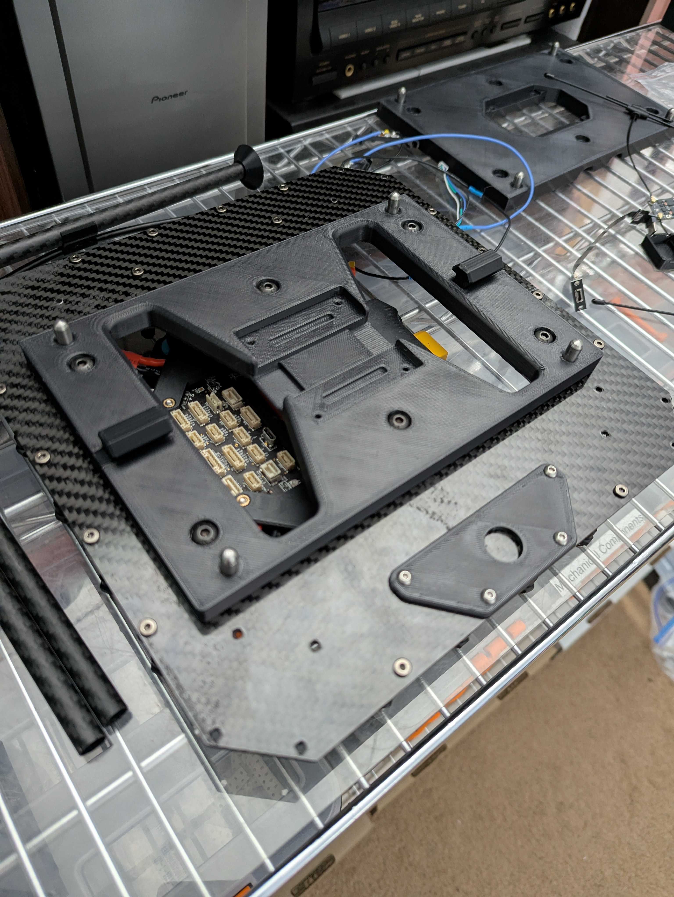
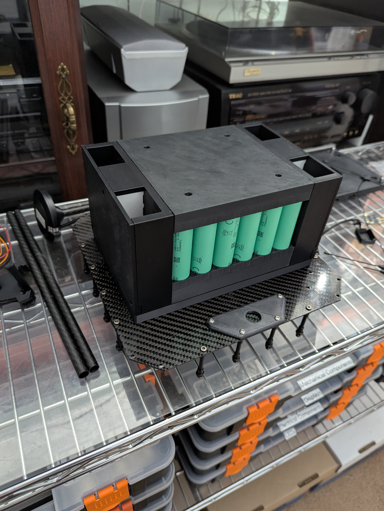
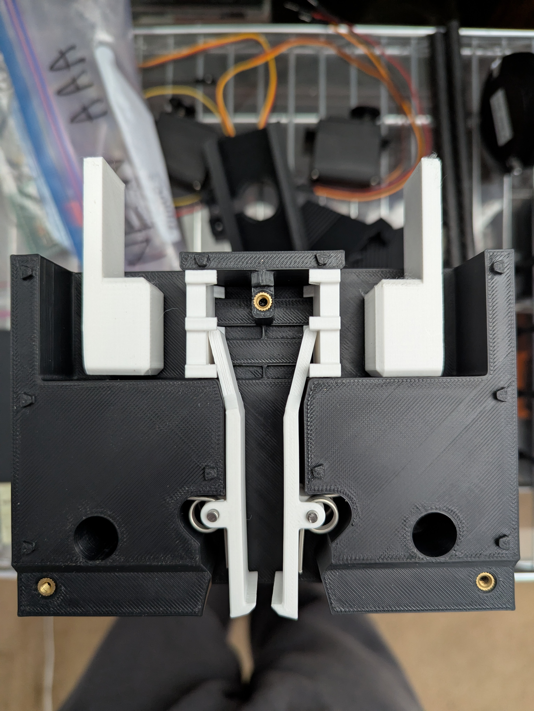
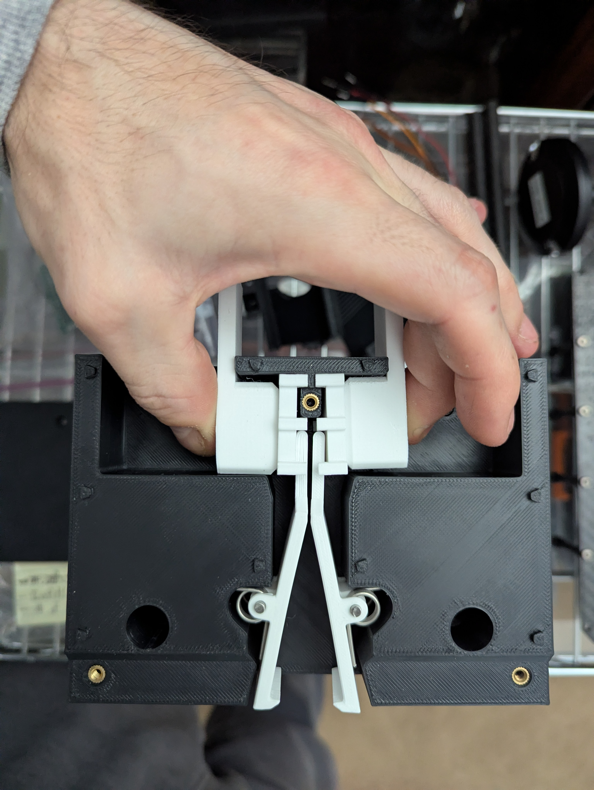
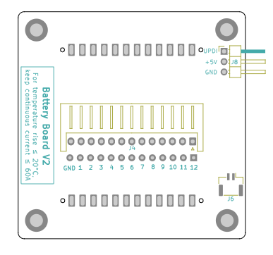
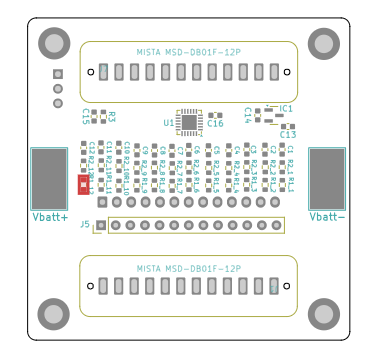
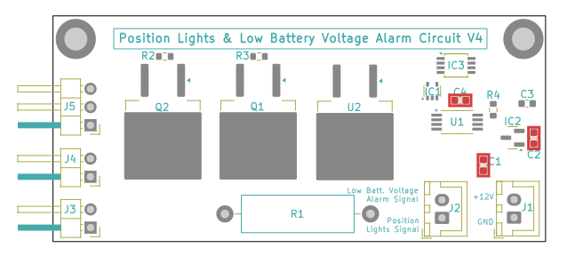
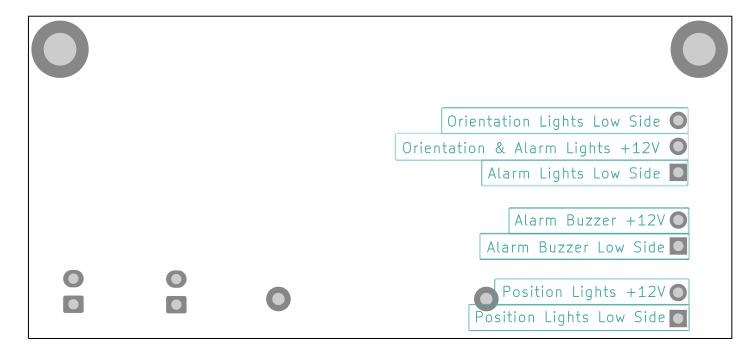

# DIY-21700-Battery-System-V2
A do-it-yourself 21700 battery for use in UAVs or UGVs. Scalable from 6s3p to 12s8p. Designed for automated battery swapping via SCARA robot arm.

STILL IN PROGRESS... CHECK BACK LATER!!!
CURRENT PROGRESS as of 2026/10/12...

(vehicle adapter and battery shown below)

  
  

(human hand and robot manipulator-compliant latching mechanism embedded in battery end plates shown below; note that the white arms are meant to represent the fingers of the robot manipulator)

  
  

(battery PCB shown below; used for measuring voltages at each busbar and temperature at a single point in the battery (via thermistor), and reporting values in MAVLink BATTERY_STATUS message over UART to the flight controller) 

  
  

(position lights and low battery voltage alarm PCB shown below; used for powering the position lights, orientation lights, and low battery voltage alarm lights and buzzer)

  
  

## IMMEDIATE TO DO
* Populate battery PCB and ground test
* Populate low voltage alarm PCB and ground test
* Create the components for demo quadrotor
* Complete the demo quadrotor and do ground testing on all functions
* Perform flight test
* Upload CAD files to GitHub only once its verified as working post flight test
* Upload PCB files to GitHub only once its verified as working post flight test
* * Update the 3p, 4p, 5p end plates

## FUTURE TO DO
* Replace UART with CAN bus (use droneCAN?): this makes the signal more robust
* make an automated battery swapping system composed of a robot arm with a gripper and some way to precisely orient the gripper to actuate the latching mechanism on the battery (maybe can use RTK GPS to make the vehicle position very accurate, move robot arm over that position, then have a camera on the robot arm find an ArUco target located next to the battery and use it to 1) orient the gripper, 2) center gripper over battery)
* Eliminate balance pins entirely (such as Tattu Plus DroneCAN battery): the battery would instead have an internal battery management system that broadcasts telemetry (real-time individual cell voltages, cycles, capacity, and temperature) directly onto a Controller Area Network (CAN) bus (use DroneCAN protocol?). The charger would reads this data dynamically to manage current distribution safely. See https://ardupilot.org/copter/docs/common-tattu-dronecan-battery.html?st_source=ai_mode
* Extend battery configuration to 24 cells in series (~100V). Requires extra safety precautions for creepage and redesign of PCBs, specifically MOSFETs in antispark circuit
* Extend end plate cell widths to 7 up to 12
